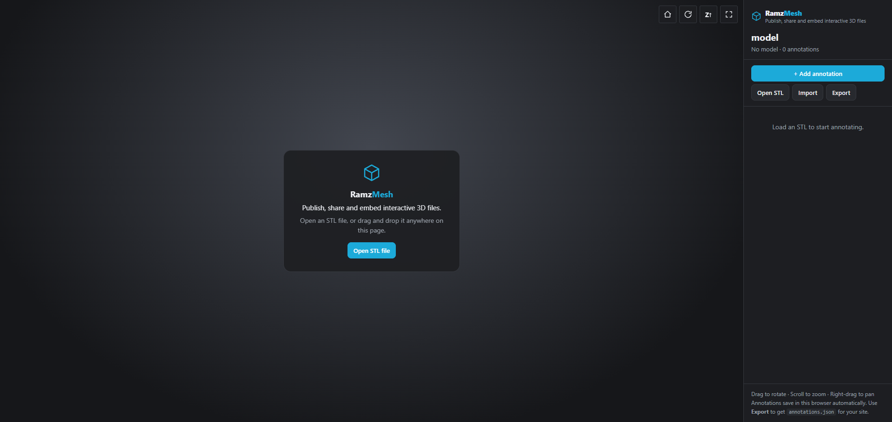

# RamzMesh

Publish, share and embed interactive 3D models with annotations, right in the browser.

<a href="assets/images/image.png"></a>

RamzMesh is a 3D viewer for STL files. Open a model, click on it to place numbered annotations, then share a link where visitors can rotate the model and read each point's info. It's plain HTML, CSS and JavaScript ([Three.js](https://threejs.org)): no build step and no backend.

## Features

- Open any `.stl` file (button or drag and drop)
- Click on the model to add annotations with a title, a description and a saved camera angle
- Edit, move, reorder and delete annotations
- Annotations auto-save in your browser; export and import them as `annotations.json`
- View mode for visitors: clickable hotspots, auto-rotate and fullscreen
- Hotspots fade when they're behind the model
- Z-up / Y-up switch for CAD and 3D-printing files
- Fast on large meshes

## Run it locally

Models are loaded over HTTP, so serve the folder instead of double-clicking `model.html`:

```bash
python -m http.server 8000
```

Then open <http://localhost:8000/model.html>. VS Code's Live Server works too.

## Add a model

1. Open `model.html` and click **Open STL**.
2. Click **+ Add annotation**, click a spot on the model, then fill in a title and description.
3. Click **Export** to download `annotations.json`.
4. Make a folder in `stl/` and put both files in it. The STL must be named `model.stl`:

   ```
   stl/
     hiiro/
       model.stl
       annotations.json
   ```

5. Share the link: `model.html?view&file=hiiro`

Folder names can use letters, numbers, `-` and `_`.

## URL parameters

| Parameter    | Example            | What it does                                     |
| ------------ | ------------------ | ------------------------------------------------ |
| `file`       | `file=hiiro`       | Loads `stl/hiiro/model.stl` and its annotations  |
| `view`       | `view`             | Visitor mode: no side panel, auto-rotate on      |
| `edit`       | `edit`             | Allows editing when `editable` is `false`        |
| `home`       | `home=false`       | Hides the reset view button                      |
| `autorotate` | `autorotate=false` | Hides the auto-rotate button                     |
| `fullscreen` | `fullscreen=false` | Hides the fullscreen button                      |

Without `file`, `model.html` opens empty, ready for a new STL.

## Embed on a website

```html
<iframe
  src="https://your-site.com/model.html?view&file=hiiro"
  width="100%"
  height="600"
  style="border: 0"
  allow="fullscreen"
></iframe>
```

## Controls

- Drag to rotate, scroll to zoom, right-drag to pan
- `←` / `→` step through annotations, `Esc` closes the info panel
- In view mode, click a hotspot to open its info; click it again or anywhere else to close it

## Settings

Edit `CONFIG` at the top of `assets/js/main.js`:

| Setting          | Default   | What it does                                                   |
| ---------------- | --------- | -------------------------------------------------------------- |
| `zUp`            | `true`    | Default up axis (most CAD and 3D-printing STLs are Z-up)       |
| `modelColor`     | `#c9ccd3` | Model color                                                    |
| `annotationZoom` | `0.6`     | How close the camera gets to an opened annotation              |
| `editable`       | `true`    | Set to `false` so visitors can only view (`?edit` still edits) |

## Project structure

```
model.html            Viewer and annotation editor
index.html            Sketchfab embed example
assets/css/style.css  Styles
assets/js/main.js     Viewer logic and settings
assets/js/vendor/     Three.js and three-mesh-bvh (bundled, nothing to install)
stl/<name>/           One folder per model: model.stl + annotations.json
```

## License

[GPL-3.0](LICENSE). Bundled libraries: [Three.js](https://github.com/mrdoob/three.js) and [three-mesh-bvh](https://github.com/gkjohnson/three-mesh-bvh), both MIT (licenses in `assets/js/vendor/`).
